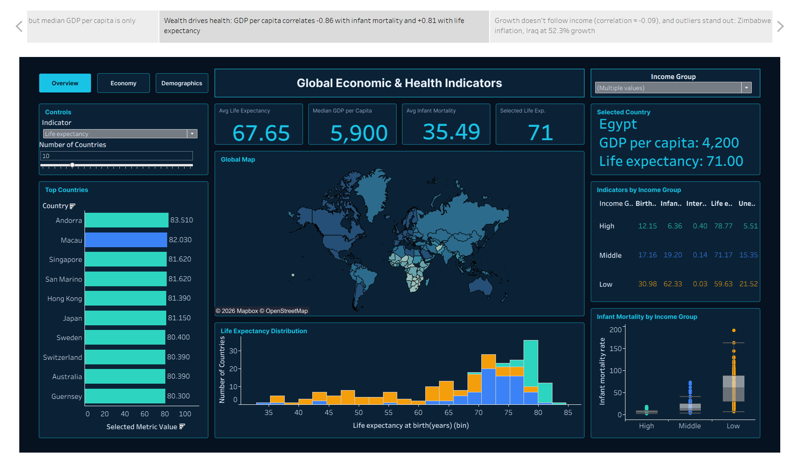

# 🌍 Advanced Tableau Storytelling & Interactive Analytics

Interactive Tableau dashboards and a data story analyzing economic, demographic, and public health indicators across 200+ countries.

<p align="center">
  
</p>

🔗 **Live dashboard:** [Add your Tableau Public link here]

---

## 📌 Overview

A research organization needs to understand how wealth, health, and demographics relate globally. This project cleans the *Country Data Comparison* dataset and presents the findings through three linked, interactive dashboards and one Tableau Story.

The data is cross-sectional (no time dimension), so the analysis focuses on comparisons between countries and income groups.

---

## 📊 Dashboards

| Dashboard | Focus |
|---|---|
| **Overview** | Global map, top-N countries, life expectancy distribution, infant mortality by income group |
| **Economy** | Inflation alerts, growth, trade balance, wealth vs. life expectancy, anomalies |
| **Demographics** | Population treemap, birth rate, internet penetration, natural increase |

---

## 🖼️ Screenshots

### Dashboard 1: Overview


### Dashboard 2: Economy


### Dashboard 3: Demographics


### Tableau Story


---

## 🛠️ Features

- **7 visualization types:** Map, Bar Chart, Histogram, Box Plot, Scatter Plot with Trend Line, Treemap, Heatmap
- **6 parameters:** Indicator, Number of Countries, High-Income Cutoff, Middle-Income Cutoff, Inflation Alert Level (%), Selected Country
- **8 dashboard actions:** 3 parameter actions, 2 filter actions, 3 highlight actions
- **Calculated fields:** Income Group, Top-N flag, selected metric, KPIs, alert flags
- **Navigation:** Overview / Economy / Demographics buttons and a global Income Group filter
- **Tableau Story:** 5 story points, each focused on one message

---

## 🔍 Key Findings

- **Correlations:** GDP per capita vs. infant mortality = **-0.86**, vs. life expectancy = **+0.81**, vs. GDP growth ≈ **-0.09**
- **Demographics:** Birth rate is **12.15** in high-income countries vs. **30.98** in low-income countries
- **Digital divide:** Internet penetration is **40.27%** in high-income countries vs. **2.50%** in low-income countries
- **Anomalies:** Zimbabwe (133% inflation), Iraq (52.3% GDP growth), Chad (38%)

**Takeaway:** Wealth strongly predicts health outcomes, but it does not predict economic growth.

---

## 📁 Repository Structure

```text
.
├── Images/
│   ├── Dashboard 1.png
│   ├── Dashboard 2.png
│   ├── Dashboard 3.png
│   └── Story.png
├── Country_Clean.xlsx
├── Project Documentation.pdf
├── Tableau Packaged Workbook.twb
└── README.md
```

---

## ▶️ How to Use

1. Download or clone the repository.
2. Open `Tableau Packaged Workbook.twb` in Tableau Desktop.
3. If Tableau cannot find the data source, re-point it to `Country_Clean.xlsx`.

Full documentation: [Project Documentation.pdf](Project%20Documentation.pdf)

---

## 🧰 Tools

Tableau Desktop · Microsoft Excel

---
